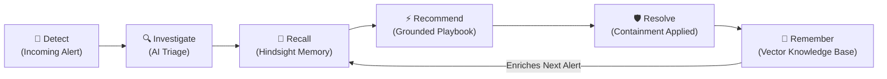

# CyberMemory AI — SOC Incident Response with Persistent Memory

[](https://vitejs.dev/)
[](https://reactjs.org/)
[](https://www.typescriptlang.org/)
[](https://tailwindcss.com/)
[](LICENSE)

> **"CyberMemory AI doesn't investigate every incident from scratch. It learns from previous incidents and uses organizational memory to provide better context for future investigations."**

CyberMemory AI is an **AI-powered cybersecurity incident response and SOC analyst platform** that uses **persistent memory powered by Hindsight** to learn from previous security incidents and provide context-aware investigation and remediation recommendations for new alerts.

---

## 🔄 The Core Learning Loop



**Feedback Loop**: `Alert → Memory → Insight → Action → New Memory`

---

## 🌟 Key Capabilities

- **Real-Time SOC Triage & Alert Correlation**:
  - Live ingestion telemetry with severity filters (Critical, High, Medium, Low).
  - High information density designed specifically for SOC Tier 1/Tier 2 analysts and Incident Commanders.
- **Hindsight Persistent Memory**:
  - Multi-hop semantic vector search across previous incidents.
  - Matches historical cases with dynamic cosine similarity scores (e.g. 94% on `#INC-2026-00317`).
  - Direct **`Memory → Current Investigation`** contextual influence indicators.
- **Cognitive AI Investigation Workspace**:
  - AI Assessment & Confidence Scoring (e.g. 91% triage assurance).
  - 5 sequential, numbered investigation steps with guidance, CLI command snippets (PowerShell/Bash), and live evidence findings.
  - "How CyberMemory AI Used Past Experience" animated memory recall pipeline.
- **Incident Resolution & Instant Memory Commitment**:
  - Pre-populated root cause analysis and multi-remediation checklist.
  - One-click **"Resolve & Store Memory"** committing the experience directly into the Hindsight knowledge graph.
- **Interactive Hindsight Memory Search & Timeline**:
  - Natural language search over historical post-mortems (e.g. *"credential compromise involving failed login attempts"*).
  - Visual timeline of organizational knowledge growth from baseline ingestion to autonomous correlation.
- **Enterprise SOC Analytics**:
  - 24-hour threat activity timeline.
  - Severity distribution donut chart.
  - Top root causes frequency breakdown.
  - Memory effectiveness metrics: **72%** investigations assisted, **84%** recommendations supported, **42m** saved per incident.
- **Floating AI Copilot ("Ask CyberMemory AI")**:
  - Docked chatbot accessible across all screens citing past incidents and precedents.
- **Interactive 11-Step Guided Demo Tour**:
  - Pinned walkthrough bar enabling evaluators, judges, and teams to step through the complete incident response story effortlessly.

---

## 🏗️ Architecture & Service Layer

```
src/
├── types/
│   ├── alert.ts             # Alert telemetry, severity, MITRE tactics
│   ├── incident.ts          # Incident investigation & resolution payloads
│   ├── memory.ts            # Hindsight memory entry & similarity metrics
│   └── analytics.ts         # SOC telemetry & effectiveness KPIs
├── services/
│   ├── alertService.ts      # Alert catalog, filtering, status updates
│   ├── memoryService.ts     # Hindsight persistent memory store & vector search
│   ├── investigationService.ts # Triage tracking, step completion toggles
│   └── aiService.ts         # AI triage, confidence assessment, Copilot chat
├── context/
│   └── SecurityContext.tsx  # Central state syncing alerts, memories, and tour
├── components/
│   ├── layout/              # Sidebar, Header, DemoFlowBanner
│   ├── common/              # GlassCard, SeverityBadge, StatusBadge, Toast
│   ├── dashboard/           # KpiStatsGrid, ThreatActivityChart, RecentAlertsTable
│   ├── investigation/       # AlertSummaryCard, AiPanel, MemorySection, RecallFlow, Modal
│   ├── copilot/             # FloatingCopilot
│   └── pages/               # Overview, Alerts, Investigation, History, Memory, Analytics, Settings
└── data/                    # Realistic cybersecurity sample data & baseline memories
```

---

## 🚀 Getting Started

### Prerequisites

- **Node.js**: v18.0.0 or higher (v20+ recommended)
- **npm** or **pnpm**

### Installation

```bash
# Clone the repository
git clone https://github.com/vedhurach-debug/CyberMemory.git
cd CyberMemory

# Install dependencies
npm install

# Start local development server
npm run dev
```

Open [http://localhost:5173](http://localhost:5173) in your browser.

### Production Build

```bash
npm run build
npm run preview
```

---

## 📋 The 11-Step Demo Workflow

1. **Step 1: Overview Dashboard** — Inspect live threat activity, active alerts, and Hindsight Memory metrics.
2. **Step 2: Select Alert** — Select `Multiple Failed Login Attempts` on `DC-01`.
3. **Step 3: Investigation Workspace** — Review technical indicators (`185.73.22.41`, `admin@company.local`, 27 attempts).
4. **Step 4: AI Analysis** — Observe the automated assessment and 91% confidence score.
5. **Step 5: Hindsight Memory Matches** — Review 5 matching historical incidents (94% match on `#INC-2026-00317`).
6. **Step 6: AI-Generated Steps** — Review the 5 recommended operational actions.
7. **Step 7: Follow Steps** — Check off completed investigation actions and inspect terminal queries.
8. **Step 8: Open Resolution Workflow** — Click **Mark Resolved**.
9. **Step 9: Commit Experience** — Specify root cause, verify applied remediations, ensure *"Save to Hindsight"* is checked.
10. **Step 10: Confirmation** — Verify the success state: *"Memory successfully stored in Hindsight"*.
11. **Step 11: Return to Memory** — Navigate to the Hindsight Memory page to see the newly minted memory node ready for future alerts!

---

## 🔒 Security & Privacy Notice

All data, hostnames (`DC-01`, `WS-1042`), IP addresses (`185.73.22.41`), and user accounts (`admin@company.local`) included in this prototype are realistic cybersecurity demo data. No real personal information or production corporate assets are included.

---

## 📄 License

Licensed under the Apache License, Version 2.0.
